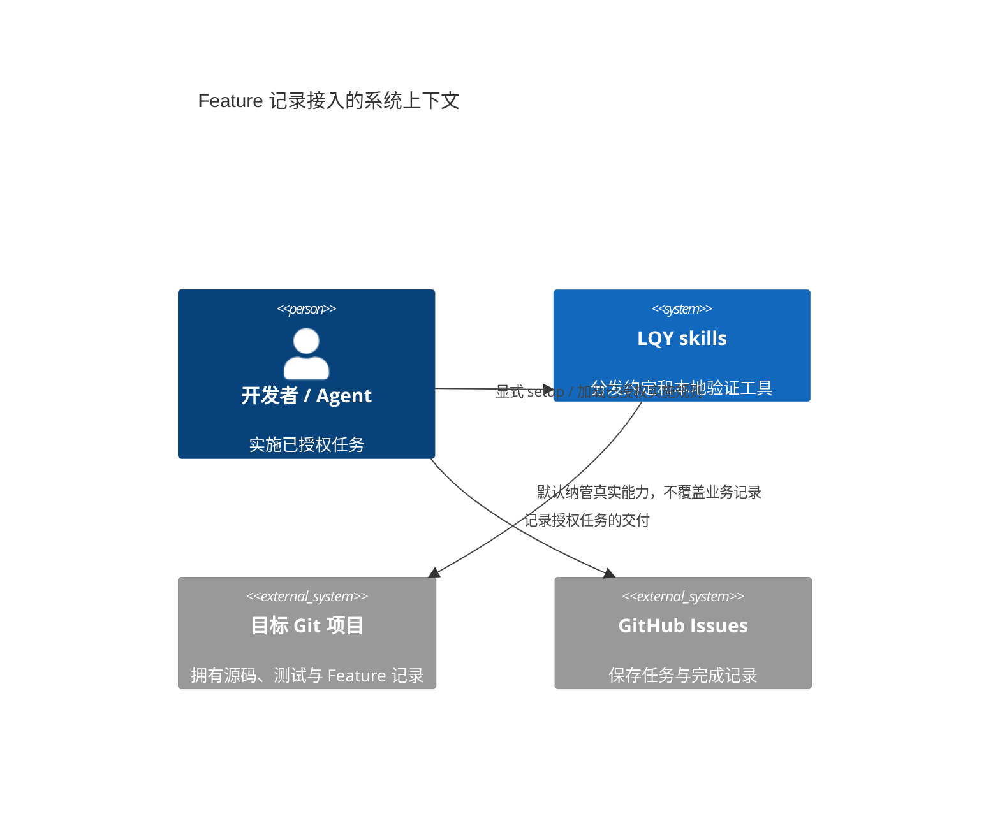
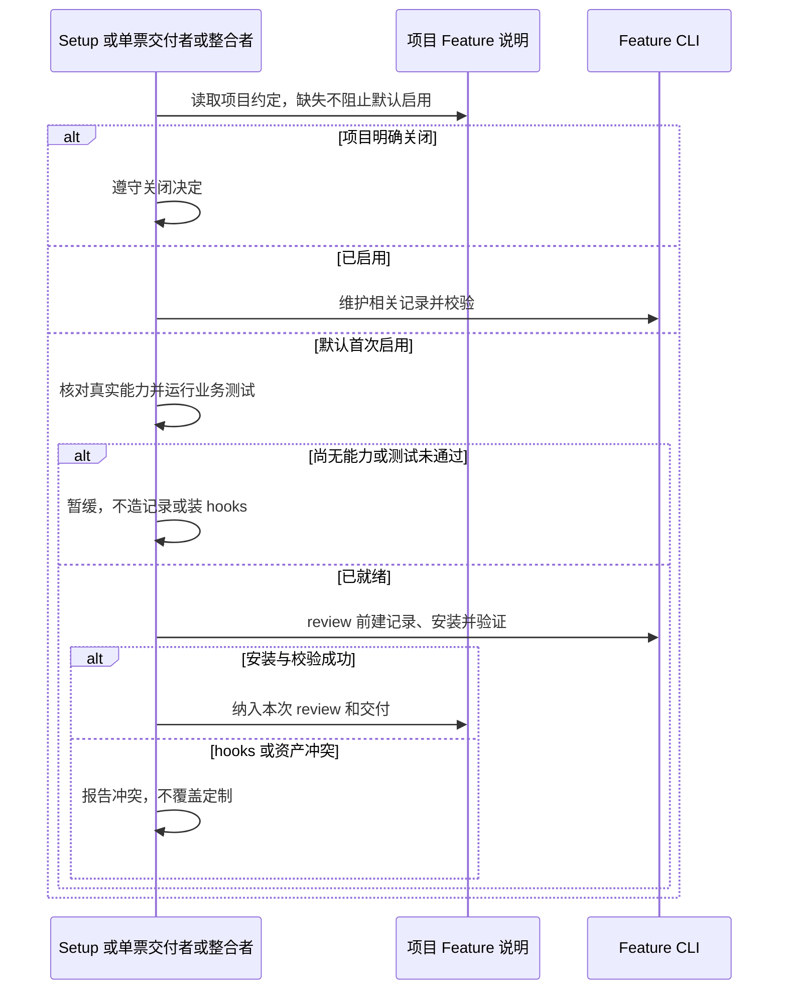
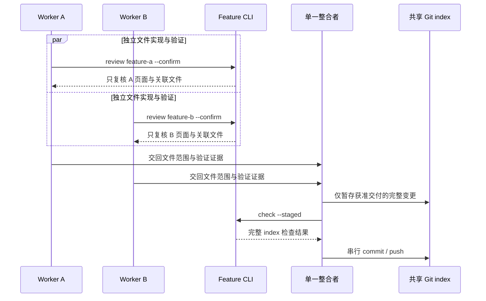

# Feature 微文档接入

## 当前 → 目标

当前：首次启用依赖项目预先保存授权标记，旧项目还需额外激活。目标：Feature 门禁默认开启，不再依赖授权标记或先运行完整 setup；在 setup 或已授权实施交付期间，只要已有真实能力且业务测试通过，就由单票交付者或整合者在 review 前启用。尚未就绪则暂缓，明确关闭则不启用。CLI 和记录格式不变；独立页面仍可并行复核，共享 Git 与构建仍串行交付。

## Module / Contract / Governance

- **Module / Interface**：setup skill 携带唯一实现；公共 CLI 为 `install/list/check/review`，项目统一入口 `.feature-docs/run`。记录仅保留 `paths/fingerprint`，标题用 Markdown H1；用途和限制在正文，任务进度归 Issues。`paths` 关联源码与测试，`fingerprint` 绑定已确认的文件版本，不表示代码审查结论。旧三/五字段仍可读取、复核且不自动改写；内部隐藏 Git 快照、归属、指纹和安装收据。
- **Adapter / Seam**：Git 是真实 Adapter；以 CLI 退出码和真实 commit/push 为 test surface。工作区、index、commit 是不同的验证输入，不能互借内容。
- **Boundary / Locality**：`.feature-docs/config.json` 记录项目选择的 `managed` 范围与安装资产；`docs/features/` 是项目数据，不放入会被 skills 同步覆盖的安装目录。
- **Governance**：Feature 门禁默认开启，旧版“未启用”不等于明确关闭，无需授权标记。setup 或已授权实施交付在真实能力测试通过后完成首次启用；worker 只交回就绪证据，由交付者在 review 前纳入记录与资产。不执行完整 setup 或改标签；只读调查和仅同步 skills 不安装 hooks。默认规则由 skills 执行，CLI 不调度安装；既有 hooks、修改过的资产或冲突配置仍拒绝覆盖。升级保留范围和业务记录，不自动刷新指纹；明确关闭决定优先。独立页面可并行复核，共享配置、Git 和构建由单一整合者串行处理；规则不是锁或调度器。
- **范围**：仅约束声明的 source globs；未纳管的目录不宣称受保护。本仓库先试用 setup、implement、已安装 skills 同步三个能力，不为每个 skill 复制说明。
- **质量边界**：Git hooks 检查记录结构、引用和版本绑定；业务测试仍由项目已有验证命令执行。不把散文准确性、业务测试通过、issue 关闭或不能绕过 hooks 伪装成 CLI 保证。
- **不变项**：to-spec/to-tickets、Mermaid gate、Ralph 调度与 Git-bound issue 契约不变；根 `./setup` 仍仅复制架构约束。
