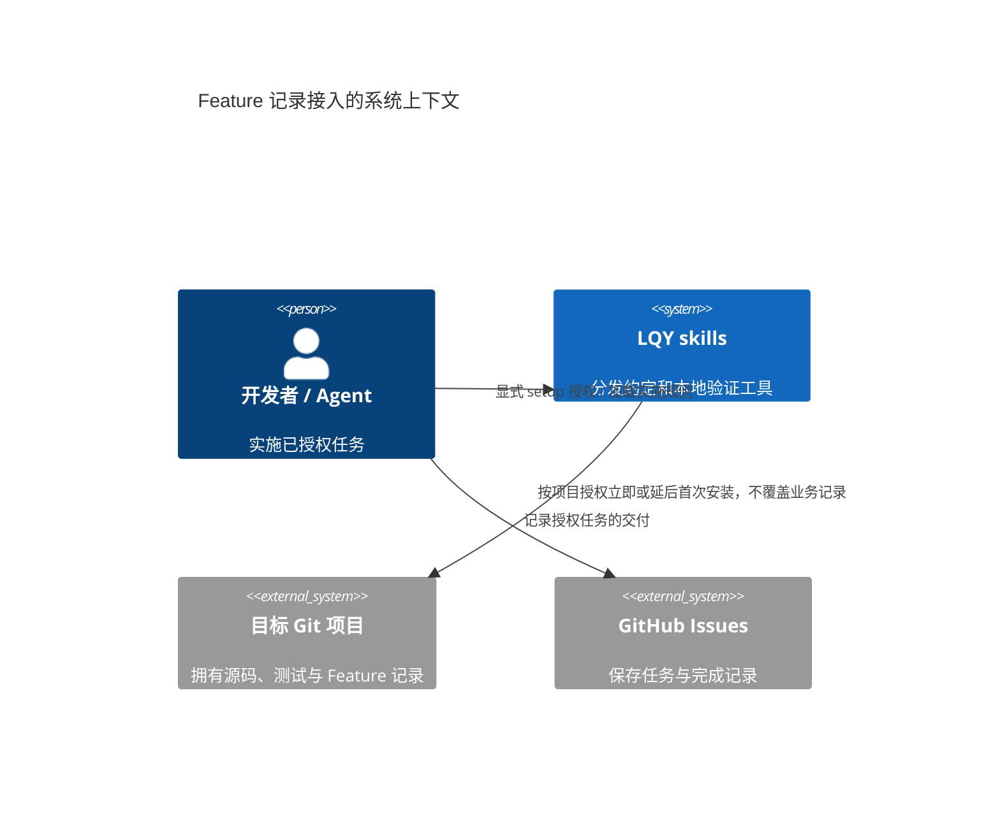
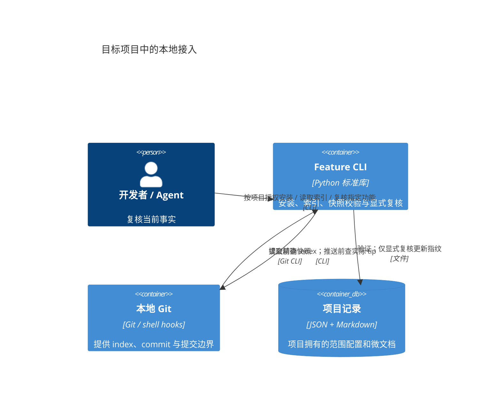
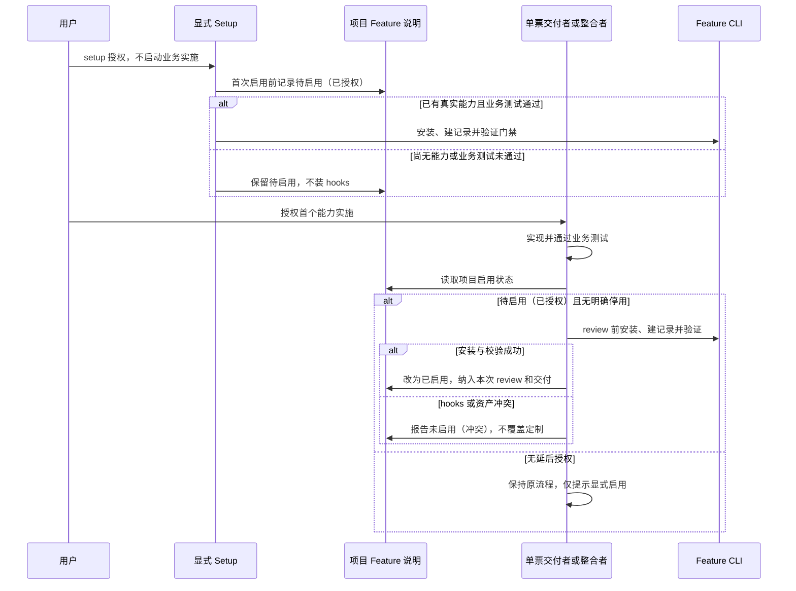
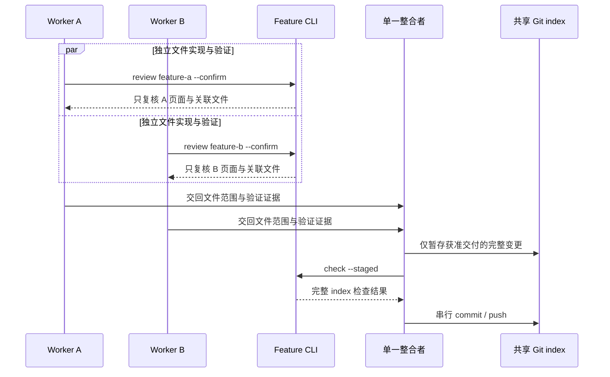

# Feature 微文档接入

## 当前 → 目标

当前：空仓库 setup 因没有真实能力而跳过门禁，后续实施只提示重跑 setup，缺少接续。目标：显式 setup 将延后首次启用的授权保存在项目说明；首个真实能力及测试通过后，由单票交付者或整合者在 review 前接续安装。无授权的旧项目保持原流程。CLI 和记录格式不变，不新增配置、调度器或锁服务；独立页面仍可并行复核，共享 Git 与构建仍串行交付。

## Module / Contract / Governance

- **Module / Interface**：setup skill 携带唯一实现；公共 CLI 为 `install/list/check/review`，项目统一入口 `.feature-docs/run`。记录仅保留 `paths/fingerprint`，标题用 Markdown H1；用途和限制在正文，任务进度归 Issues。`paths` 关联源码与测试，`fingerprint` 绑定已确认的文件版本，不表示代码审查结论。旧三/五字段仍可读取、复核且不自动改写；内部隐藏 Git 快照、归属、指纹和安装收据。
- **Adapter / Seam**：Git 是真实 Adapter；以 CLI 退出码和真实 commit/push 为 test surface。工作区、index、commit 是不同的验证输入，不能互借内容。
- **Boundary / Locality**：`.feature-docs/config.json` 记录项目选择的 `managed` 范围与安装资产；`docs/features/` 是项目数据，不放入会被 skills 同步覆盖的安装目录。
- **Governance**：显式 setup 包含首次安装及空仓库延后接续的授权；仅该次 setup 可在项目 `docs/agents/feature-docs.md` 的 `## 项目启用状态` 下记录 `启用状态：待启用（已授权）`，明确停用决定优先。首个能力测试通过后，由单票交付者或整合者在 review 前接续；worker 只交回就绪证据。安装 skill、同步模板和旧版“未启用”说明均不授权；接续也不重跑完整 setup 或改标签。CLI 不解释授权状态，由 skills 执行此约定；既有 hooks、修改过的安装资产或冲突配置仍拒绝覆盖。升级保留范围和业务记录；不自动生成能力事实或刷新业务指纹。独立页面可并行复核，共享配置、Git 和构建由单一整合者串行处理；规则不是锁或调度器。
- **范围**：仅约束声明的 source globs；未纳管的目录不宣称受保护。本仓库先试用 setup、implement、已安装 skills 同步三个能力，不为每个 skill 复制说明。
- **质量边界**：Git hooks 检查记录结构、引用和版本绑定；业务测试仍由项目已有验证命令执行。不把散文准确性、业务测试通过、issue 关闭或不能绕过 hooks 伪装成 CLI 保证。
- **不变项**：to-spec/to-tickets、Mermaid gate、Ralph 调度与 Git-bound issue 契约不变；根 `./setup` 仍仅复制架构约束。
