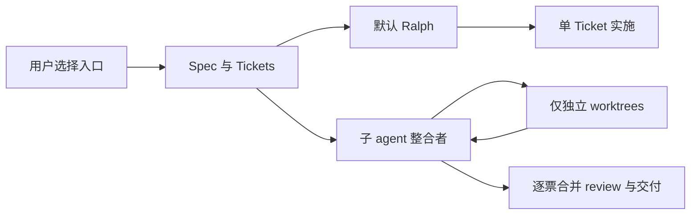
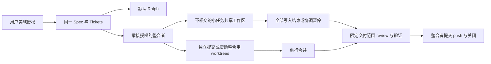
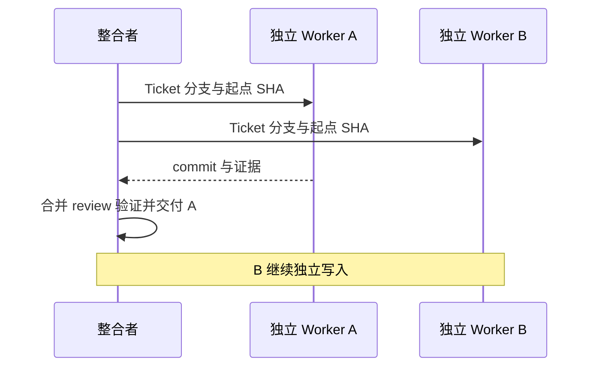
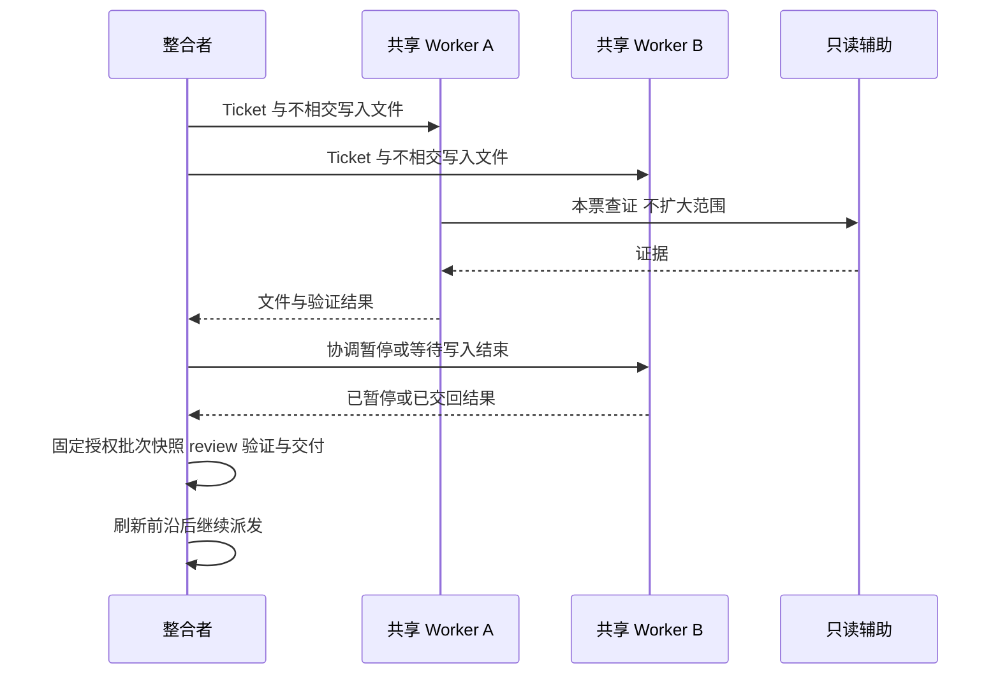
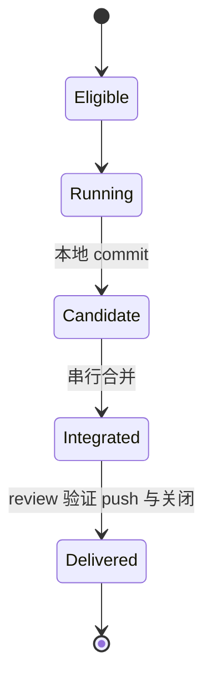
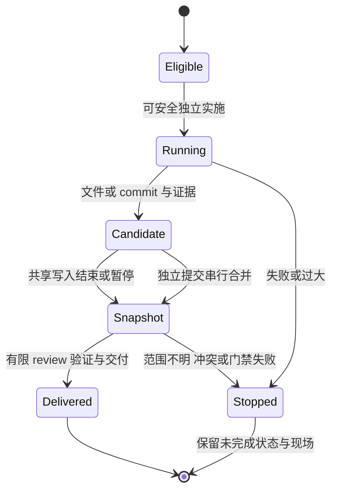
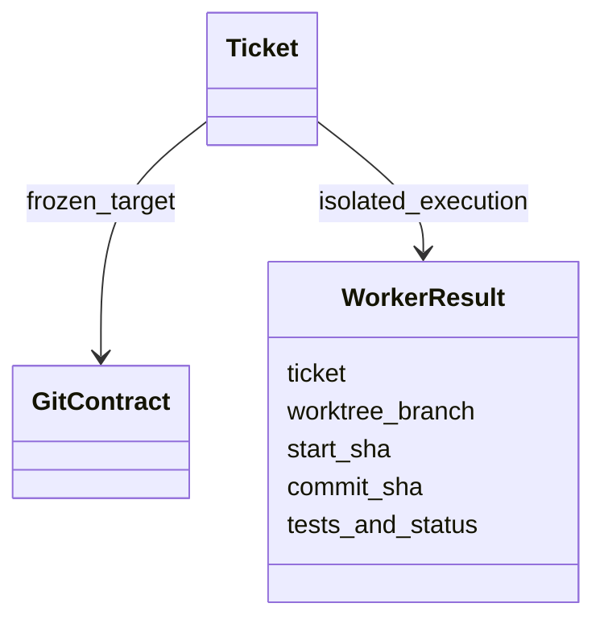
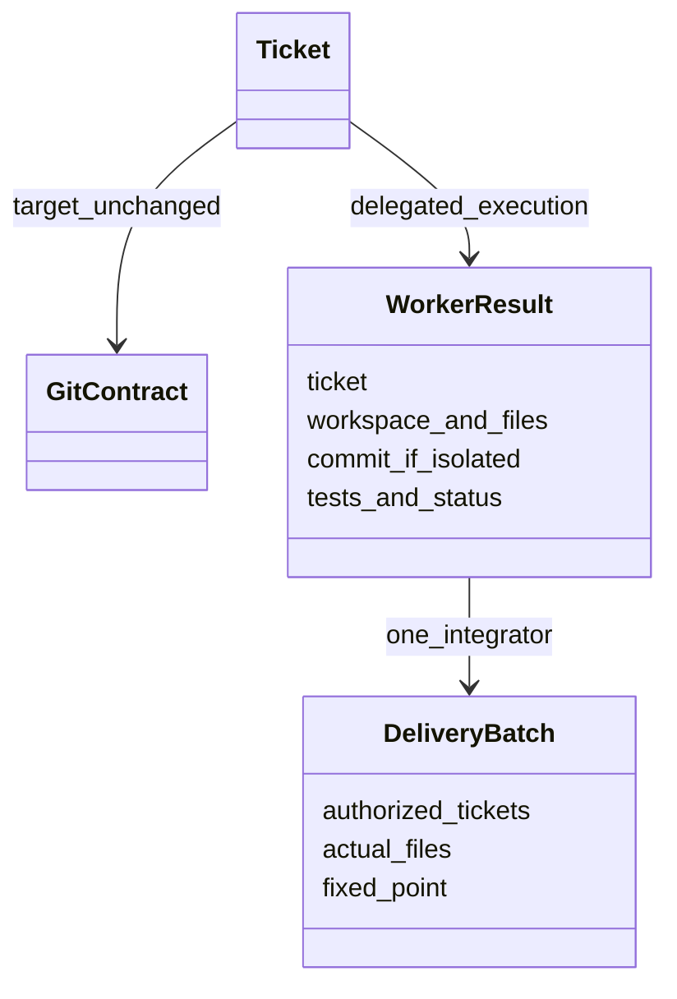

# Spec 实施入口

Ralph 默认不变；子 agent 入口复用 Spec/Tickets，根据项目约定与实际风险选择共享工作区或独立 worktree。单一整合者收口，共享写入暂停后验证同一快照。不新增调度平台、配置模式或 Git 字段。

C4：用户/GitHub 为 Context，Git 仓库/AI 会话为 Container，规划/实施/review 为 Component；类图描述文档合同。Module 是实施入口，Interface 是已授权 Spec 和项目规则；Implementation 隐藏派发、协调与交付。Depth 来自复用既有 gate/TDD/review，Seam 是 Ticket 与 worker 证据，Adapter 是已有子 agent 能力；合同集中提供 Leverage/Locality。test surface 为文件合同、加载与 Git/publisher 回归，不宣称模型执行或运行时锁已验证。

## 架构 / 调用

当前：

目标：

## 时序

当前：

目标：

## 状态

当前：

目标：

## 文档合同

当前：

目标：

Boundary/Contract/Governance：授权可由主流程传递，规划确认仍不等于实施授权。worker 可在范围内做只读辅助委派，不再拆派实施或绕过 review 预算。共享 worker 不操作 Git/index，整合者在写入全部交回或协调暂停后，对明确授权的文件/批次做有限 review、完整验证和交付；其它工作不混入。独立 worktree 可本地 commit，支持逐票滚动整合；项目禁止新工作区时不自行绕过。最终 Git/blocker 合同与 publication gate 不变，不与其它实施流程消费同一批任务。review 是单票或明确批次的既有双轴纪律，不按 worker 数增加预算。
