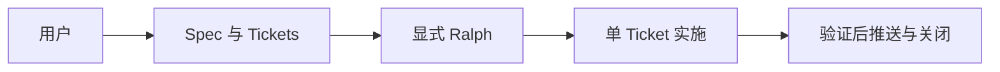
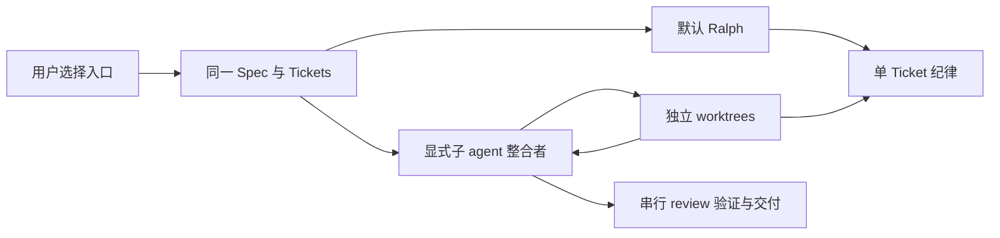
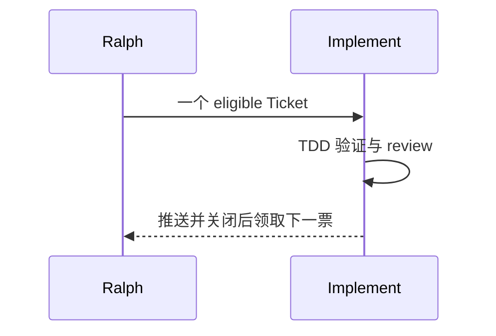
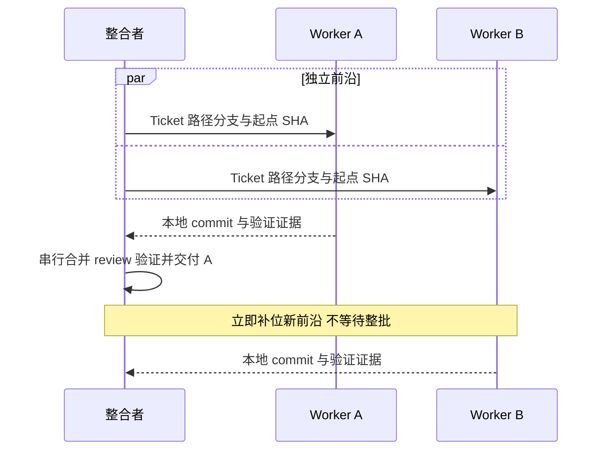
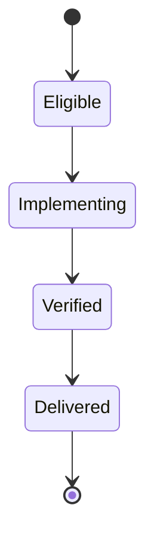
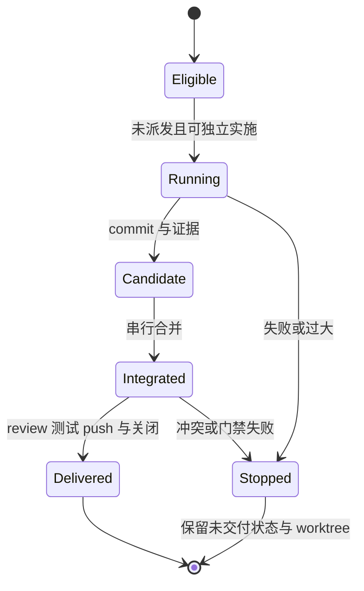
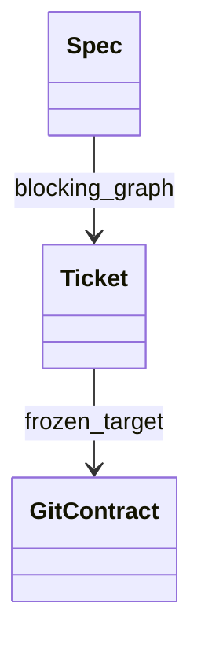
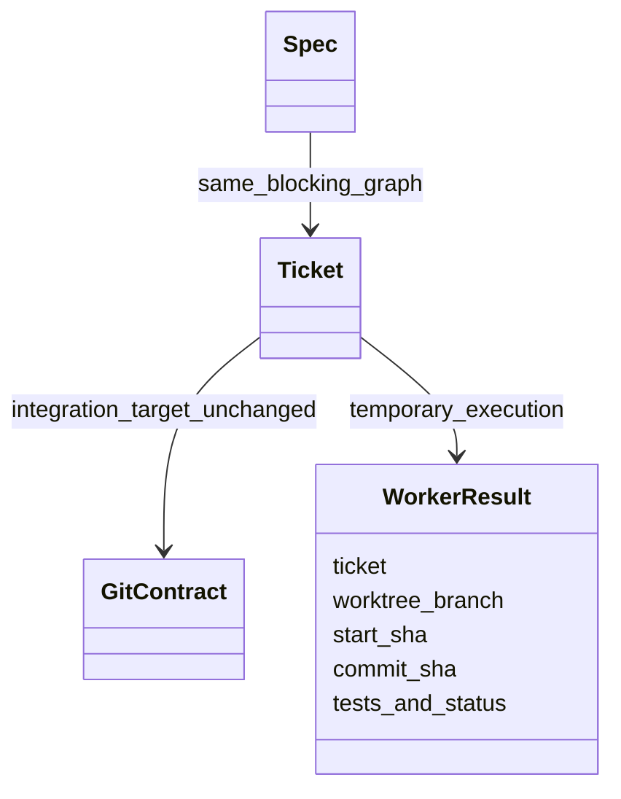

# Spec 实施入口

Ralph 保持默认；显式 `implement-spec-subagent-lqy` 复用同一份 Spec/Tickets，独立 worktree 实现，单一整合者交付。不新增调度平台、配置模式或 Git 契约字段。

C4：用户与 GitHub 为 Context；目标 Git 仓库与 AI 会话为 Container；规划、实施、review 为 Component；类图仅描述已有文档合同。Module 为新实施 skill，Interface 为 Spec 引用和明确启动；Implementation 隐藏派发、隔离与整合。Seam 是 Ticket/Git 合同和 worker 结果，Adapter 是宿主已有子 agent 工具；复用既有验证与单票纪律获得 Leverage/Locality。test surface 为 skill 文件合同、skill 加载及既有 Git/publisher 回归；指令不等于运行时锁或端到端保证。

## 架构 / 调用

当前：

目标：

## 时序

当前：

目标：

## 状态

当前：

目标：

## 文档合同

当前：

目标：

Boundary/Contract/Governance：规划只生成依赖与并行风险，不实施。新入口只处理用户授权 Spec 的 eligible Tickets，整合者在集成 worktree 复用现有 gate；私有工作分支不是 Ticket 新目标。worker 不 push/关闭 issue，不嵌套调度；review 留在主线程，避免依赖子 agent 的再次派发能力。无法并行或隔离则报告阻塞，不静默切换执行入口。与 Ralph/其它整合者的互斥是执行前提，不宣称文档提供 OS 锁；失败保留现场，合入且验证通过后才释放依赖。
