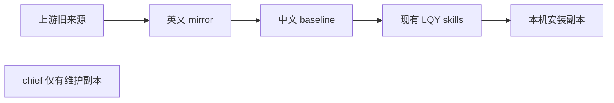
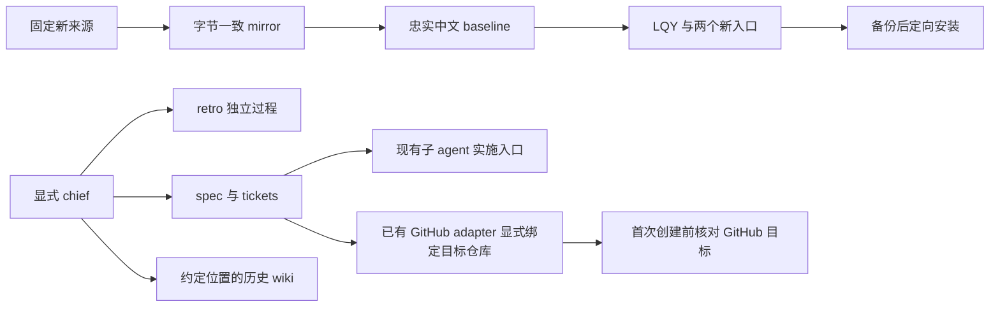
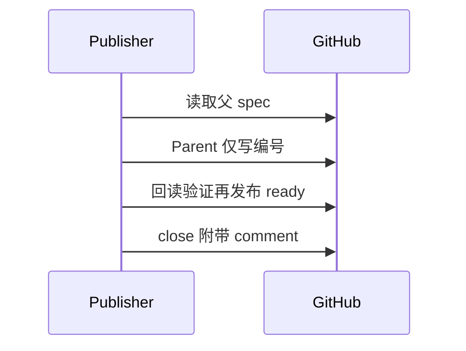
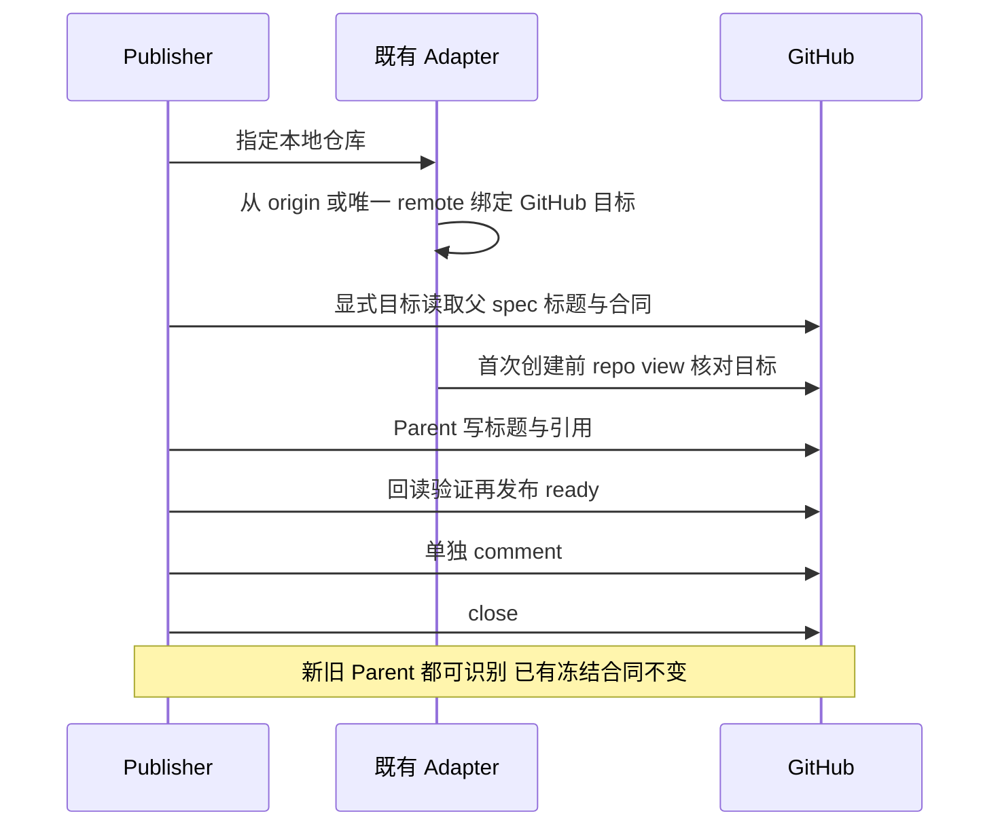
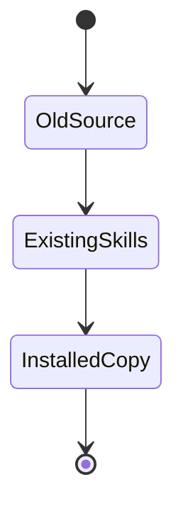
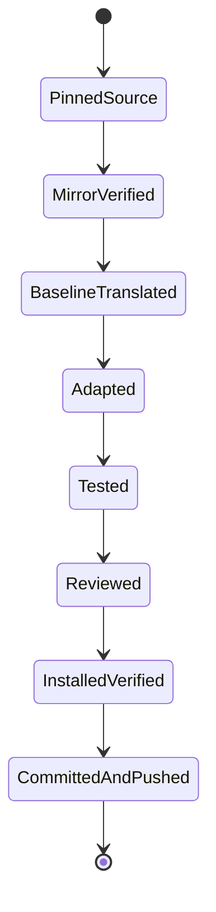
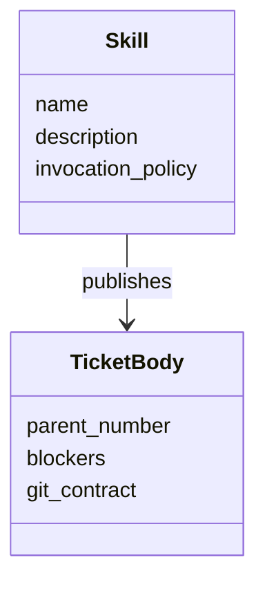
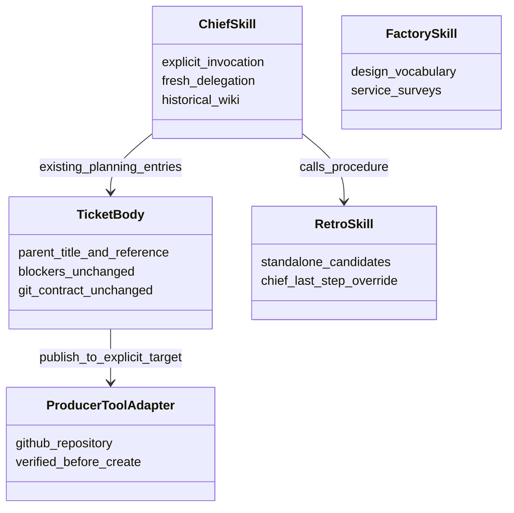

# Matt Pocock 上游同步与融合

本轮固定来源：`mattpocock/skills@bbadaa631c37af594e5a05c9cefacd9956136b18`（2026-11-27，v1.3.2 + main）。旧 active 来源为 `49dd158d1076134a641b33efb035946536778336`。英文源文件保持字节一致；中文 baseline 忠实翻译，不混入 LQY 定制；安装版仅做已确认差异、命名及真实工具适配。8 个 frozen legacy 保留原来源。

## 已确认范围

- grilling 按上游整轮提问、独立上下文 subagent 查证且不阻塞无关问题；保留 LQY 的共识/实施授权分离与文档版下一步提醒。
- 吸收术语关系、Parent 标题与引用、GitHub 操作修复、新 agent 上下文规则；保留 GitHub-only、中文、Ralph、Git/blocker、工作区和有限 review 合同。setup 缺 GitHub remote 时停止，旧术语表不自动迁移。
- 新增并安装 `software-factory-lqy`、`chief-of-staff-lqy`，完整跟进英文、中文和支持文件；chief 的委派、wiki、抽样 retro 及后续处理按上游，不额外添加本地审批。retro 仍独立存在，独立调用的建议模式不变。
- 更新本机已安装的同名 skills，备份且保留安装独有定制；不运行 chief、Ralph、setup 或 schedules，不预先创建 wiki。

## 局部设计 Gate

涉及新 skill 调用关系及公开 Parent 格式，因此先记录局部当前/目标图，再改实现；不新增调度服务、接口层或 ADR。

Module：三层 skill 文档、Ticket publisher、仓库 validator。Interface：SKILL.md/调用 metadata、Parent/Blocked by/Git 正文和现有 CLI。Implementation：翻译、文件同步和 publisher 格式化；Depth/Leverage/Locality 来自沿用已有 adapter、门禁和验证。Seam/test surface：安装发现、文件合同及 fake-gh CLI；Adapter 仍是现有 GitHub/子 agent 能力。C4 的 Context 为用户/上游/GitHub，Container 为仓库/安装目录/运行会话，Component 为 skills/publisher/check，Code 层是下列文档字段与 publisher；Governance 保留用户已指定的 LQY 合同，chief 的新增调用关系忠实遵循上游。

### 架构 / 调用：当前

### 架构 / 调用：目标

### 时序：当前

### 时序：目标

### 状态：当前

### 状态：目标

### 文档合同：当前

### 文档合同：目标

## 交付证据

| 检查 | 当前证据 |
| --- | --- |
| 英文原文 | 39 active / 109 源文件与固定 SHA 逐字节、可执行位一致，无多余文件；8 frozen / 9 源文件与各自旧 SHA 一致，17 个含 provenance 的 frozen 文件相对实施前不变 |
| 中文与新安装版 | 13 个既有正文增量逐项对照源 diff；software-factory 全部 6 份 MD 保留原结构、链接和命令，5 份支持文档与 LQY 字节一致；chief 仅改名字及实际路径调用方式，不增加审批规则 |
| 仓库维护 | validator 通过：54 installable / 41 Matt LQY / 47 baseline / 47 mirror；维护合同测试 38 通过 |
| 既有回归 | blocking 修复后全量重跑：Ralph 71、setup 30、to-spec 7、to-tickets 26、triage 9 通过；与维护测试合计 181 |
| 安装发现 | `npx skills@latest add . --list` 仅发现 54 个安装版，两个新名可见，mirror/baseline 不泄漏 |
| 原生加载 | Pi 1.7.0 loader：54 个、零 diagnostics，新入口不进入隐式 prompt；Codex 0.172.0 隔离 HOME 的 `skills/list`：54 个仓库 skill、零 errors，新 interface 加载，未启动 model turn |
| 图与记录 | grok-mermaid 0.2.3 渲染局部设计和既有实施图各 8 张，共 16 张，零 warnings；3 个相关 Feature 记录按实际证据复核 |

新 Parent 输出和兼容冻结合同、comment-before-close、grilling、新上下文、chief/retro 调用以及安装边界均有 RED → GREEN 或对应文件合同验证。文本与原生加载不证明真实模型驱动的 chief、软件工厂或 Ralph 端到端执行，本次不运行这些流程。

Broad Review 的 Spec 为 accepted；Standards 报告一项 High：publisher 的目标核对尚未落入真实调用，fork 默认上游可误发。已在原 adapter 吸收本机既有目标绑定，补上首次创建前的目标/schema/可达性核对，并对现有 triage API 使用显式 hostname 和 endpoint；不改变领取/工作区/锁协议。新增回归先 RED（错误目标、缺少 repo view）后 GREEN，181 个测试已重新通过。将两个实际 adapter 源/测试路径纳入既有 Ticket Feature 范围，没有新增门禁工具。

Standards reviewer：`af59dcde-6ff2-4e6`；Spec reviewer：`1fcf7ef9-eef6-45f`。原 reviewers 的 Focused Closure 均为 accepted / closed，无新 Critical/High；Standards 明确先前 wrong 仅由该 High 导致，并非整体方案错误。共 4 次 review 调用，无第三轮。两轴确认后冻结 192 文件做一次受限 Clean 判断，保留原文、三层维护结构及已测试兼容合同，没有产生变更；diff 哈希前后一致，维护 38 测试和 validator 再次通过。

## 本机安装与保护

备份：`~/.cache/skills-sync-lqy/install-backups/2026-11-28-sn9v42he/`，含 22 个已有 Matt skill、额外 Ralph 目录、安装前后 SHA-256 清单及更新 manifest。

- 更新 22 个已有 Matt skills，新增 `chief-of-staff-lqy`、`software-factory-lqy`；实际变更 53 文件（42 更新、11 新增），非缓存文件由 2234 增至 2245，其余文件逐项核对未变。不安装维护用英文 mirror / 中文 baseline。
- 不整目录覆盖。to-spec / to-tickets 的扁平安装测试 fixture 路径合入新版；原安装的 GitHub 目标绑定及相关测试已提升到仓库并保留能力。Ralph 仅同步该 adapter 与测试，信号处理、工作区定制、原 clean 及所有其它非目标文件字节保持不变。
- 安装版 adapter 13、to-spec 7、to-tickets 26 测试直接通过。安装版 triage 直接运行的 9 项先因测试 fixture 仍假定仓库分组路径而失败；仅在测试进程将 adapter/validator 两个 fixture 根指向实际扁平安装目录后，9 项通过，没有修改生产代码或安装测试文件。此限制不隐藏成默认安装测试已全绿。
- 实际 Pi 安装目录加载 70 个 skills、零 diagnostics，24 个 Matt 目标全部发现，新两项保持显式入口。Codex 在隔离 HOME 中读取实际安装目录，24 个 Matt 目标全部发现、零 errors、新 interface 加载，没有 model turn。
- 安装前后清单再次证明所有非目标文件未变；本轮没有运行 chief、Ralph、setup、定时任务或创建 wiki，也没有写入真实 GitHub issues / 标签。

Git 交付目标为当前 `main → origin/main`；本页随此批次提交，提交号以 Git 历史和交付回复为准。Pi 使用 `/reload` 或新会话，Codex 使用新会话加载；已经读入当前会话的旧正文不会自动替换。
